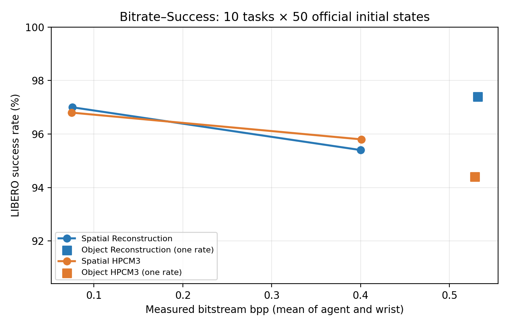

# HPCM3 论文 Bitrate–Success 对照

全部正式结果为官方 DEFAULT 初始状态、每 task 50 episodes、seed 7；同 suite、同 λ 两路径的 500 个 initial-state SHA 逐项相同，HPCM 和 VLA 权重 SHA 一致。Spatial 四点的 Spatial-Pro 权重 SHA 一致。全部 exact train-frame match 为 0；RLDS PNG 缺少 demo 完整 simulator state，仍**无法排除** demo 与正式初始状态等值。具体配置与逐 episode 证据见 CSV 的 `source` 路径和各实验报告。

| Suite | λ | 路径 | 成功率 | agent / wrist 实际 bpp | agent / wrist PSNR dB |
| --- | ---: | --- | ---: | ---: | ---: |
| Spatial | 0.0018 | Reconstruction | 485/500 (97.0%) | 0.0704 / 0.0810 | 32.96 / 32.13 |
| Spatial | 0.0018 | HPCM3 | 484/500 (96.8%) | 0.0702 / 0.0797 | 32.97 / 32.20 |
| Spatial | 0.0483 | Reconstruction | 477/500 (95.4%) | 0.3682 / 0.4322 | 41.13 / 40.95 |
| Spatial | 0.0483 | HPCM3 | 479/500 (95.8%) | 0.3677 / 0.4343 | 41.13 / 40.93 |
| Object | 0.0483 | Reconstruction | 487/500 (97.4%) | 0.5540 / 0.5098 | 39.01 / 39.81 |
| Object | 0.0483 | HPCM3 | 472/500 (94.4%) | 0.5553 / 0.5020 | 未记录 |

图的横轴是两视图各自真实 y/z bitstream bpp 的算术平均，不是 HPCM λ，也不是估计码率。HPCM3 的 PSNR 若有记录，仅是同一策略实际观察帧的**诊断性重建**，重建 RGB 并未输入该策略。各策略闭环轨迹不同，轨迹均值不能视为逐帧配对画质。Object HPCM3 历史 500-episode 运行未记录 PSNR，因此留空。

Spatial 在 λ=0.0018 和 0.0483 均有同协议 Reconstruction/HPCM3 正式对照，可连成各自的两点曲线。Object **只找到 λ=0.0483 checkpoint**，仅有一组双路径单点；没有第二码率，不连接成曲线，也不填充虚构点。更高码率检索见[checkpoint 核查](hpcm_object_higher_rate_checkpoint_inventory.md)。历史低码率 Spatial HPCM3 因输入协议不同未混入主表。不能仅凭这些点外推码率趋势或断言 HPCM3 优于重建。

## 每个任务成功次数（分母均为 50）

| Task | Spatial 0.0018 Rec | Spatial 0.0018 HPCM3 | Spatial 0.0483 Rec | Spatial 0.0483 HPCM3 | Object 0.0483 Rec | Object 0.0483 HPCM3 |
| ---: | ---: | ---: | ---: | ---: | ---: | ---: |
| 0 | 50/50 | 50/50 | 50/50 | 50/50 | 48/50 | 40/50 |
| 1 | 50/50 | 50/50 | 48/50 | 49/50 | 49/50 | 46/50 |
| 2 | 50/50 | 50/50 | 50/50 | 50/50 | 50/50 | 50/50 |
| 3 | 50/50 | 50/50 | 50/50 | 49/50 | 42/50 | 45/50 |
| 4 | 49/50 | 50/50 | 49/50 | 49/50 | 50/50 | 47/50 |
| 5 | 41/50 | 38/50 | 33/50 | 37/50 | 49/50 | 46/50 |
| 6 | 50/50 | 50/50 | 49/50 | 50/50 | 50/50 | 49/50 |
| 7 | 48/50 | 48/50 | 50/50 | 48/50 | 49/50 | 49/50 |
| 8 | 47/50 | 48/50 | 48/50 | 48/50 | 50/50 | 50/50 |
| 9 | 50/50 | 50/50 | 50/50 | 49/50 | 50/50 | 50/50 |

[CSV](../results/hpcm3_paper_bitrate_success/paper_table.csv)和[绘图数据](../results/hpcm3_paper_bitrate_success/plot_data.json)保留完整 checkpoint/结果 SHA。500-episode 原始 JSONL 和审计限定分别见[Spatial 高码率与重建](hpcm3_spatial_bitrate.md)、[Spatial 低码率重训](hpcm3_spatial_lowrate_retrain_500.md)、[Object HPCM3](hpcm3_object_highrate_libero4_full_500.md)、[Object RGB 重建](hpcm3_object_highrate_reconstruction_full_500.md)。大体积权重和逐帧 audit 不上传 Git。
