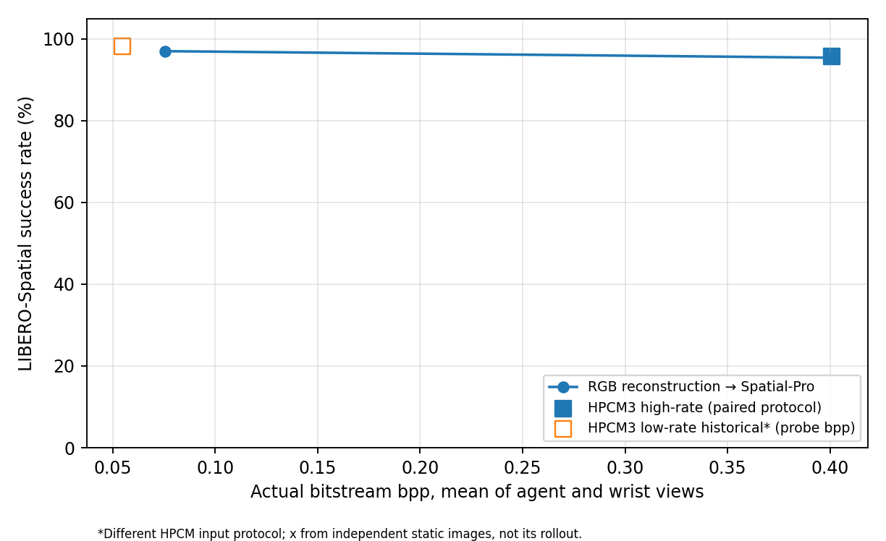

# LIBERO-Spatial Bitrate–Success Rate 实验

使用同一 Spatial-Pro 权重、官方 DEFAULT 初始状态（10 tasks × 50）、seed 7、10 dummy steps 与 8-action queue。新增三组评测使用相同 raw 256 RGB 熵编码输入，并对每个 task/episode 核对初始 state SHA 与首个双视图 RGB SHA。原始 Spatial-Pro 基线未重跑。只有本地已有 λ=0.0018 与 0.0483 两个 HPCM checkpoint，**没有中间码率点**。

| λ | 路径 | Success | Agent / wrist 实际 bpp | Agent / wrist PSNR dB | Exact train-frame matches |
| --- | --- | ---: | ---: | ---: | ---: |
| 0.0018 | reconstruction | 485/500 (97.0%) | 0.0704 / 0.0810 | 32.96 / 32.13 | 0 |
| 0.0483 | reconstruction | 477/500 (95.4%) | 0.3682 / 0.4322 | 41.13 / 40.95 | 0 |
| 0.0483 | hpcm3 | 479/500 (95.8%) | 0.3677 / 0.4343 | 41.13 / 40.93 | 0 |

高码率两条路径共享 Spatial-Pro、HPCM、codec 数值预处理及官方初始状态；后续闭环轨迹不同，故整段轨迹的 bpp/PSNR 是各自策略实际看到的图像分布，不是逐帧配对图像指标。表中 bpp 为真实 y/z bitstream 字节数除以 256²；PSNR 使用熵解码 RGB。每组 500 episode 的初始 state SHA、成功/失败、每 task 结果及逐查询 bpp/PSNR 在[结果目录](../results/hpcm3_spatial_bitrate/)；完整逐帧 SHA audit 留在机械盘，Git 仅保存路径和文件 SHA。新增三组每组抽检 20 张视图（每 task 首次查询双相机）的 bitstream 熵解码 latent 与 HPCM3 forward latent 完全一致，max abs=0；并非逐帧证明。训练图像与评测 raw RGB 的 exact SHA 匹配为 0。

高码率重建与 HPCM3 仅相差 **2/500（0.4 个百分点）**。按配对初始状态比较，重建独赢 6 个、HPCM3 独赢 8 个；差距很小，不能据此宣称 HPCM3 控制性能优于重建。低码率重建比高码率重建多成功 8 个，配对状态低码率独赢 12、高码率独赢 4；闭环结果在此样本上**不单调**，不能以 PSNR 更高推断成功率必然更高。

## 各 task 成功次数

| Task | λ=0.0018 重建 | λ=0.0483 重建 | λ=0.0483 HPCM3 |
| ---: | ---: | ---: | ---: |
| 0 | 50/50 | 50/50 | 50/50 |
| 1 | 50/50 | 48/50 | 49/50 |
| 2 | 50/50 | 50/50 | 50/50 |
| 3 | 50/50 | 50/50 | 49/50 |
| 4 | 49/50 | 49/50 | 49/50 |
| 5 | 41/50 | 33/50 | 37/50 |
| 6 | 50/50 | 49/50 | 50/50 |
| 7 | 48/50 | 50/50 | 48/50 |
| 8 | 47/50 | 48/50 | 48/50 |
| 9 | 50/50 | 50/50 | 49/50 |

## 历史低码率 HPCM3 的使用边界

既有 Spatial HPCM3 [完整评测](../results/hpcm3_libero4/spatial/summary.json)为 **491/500（98.2%）**，Adapter SHA `2860078fd497f3453846f21f9d5ac809307e9deb2ceaf134b4153f161c83a501`，不重跑。它与新增三组具有相同 Spatial-Pro、seed 和 500 个 DEFAULT 初始状态，但其 `hpcm_raw_input_bypass=false`：HPCM 接收 policy-processor 分支的图像，**不同于本轮 raw 256 输入**。历史结果也未记录每次策略查询的真实 bitstream。因此图中的空心历史点横坐标仅取独立 40 张 Spatial fresh-reset 图像上 λ=0.0018 的真实码率均值（agent/wrist 0.0616/0.0478 bpp），**不是历史 rollout 的码率**，不能与实心点连接为同协议 HPCM3 曲线，也不能将高低码率 HPCM3 的差异归因于码率。低码率同协议 HPCM3 结果按要求没有重跑；严格的双路径、双码率论文曲线仍缺这一点。

## 训练、隔离和局限

唯一新增训练是 λ=0.0483 Spatial HPCM3，从随机初始化；四套 LIBERO 的全部训练轨迹图像，统一 Spatial-Pro block-2 teacher、2 ResBlocks、`SigLIP_MSE + 5×DINO_MSE`，无架构/loss 搜索。按 trajectory 划分 train 1523 / val 170 条，训练 RGB **493840** 张，val RGB **53090** 张，验证图像固定抽样 512；训练预算上限 100000 optimizer steps × batch 16，实际 **100000** steps，best clean val loss **0.016317**。独立 Spatial simulator 40 张 fresh-reset 图像只作诊断、不参与选模。best Adapter SHA `3f032ae64b5baf846b61bf2623ac818d252c506a2d10cf406a90729c747506c4`。HPCM λ=0.0018 SHA `dc7a6c0f4b93f2294df1ce5fc49a21ab5d8107b91c14e0ee819a9f8dbbb30964`；λ=0.0483 SHA `d0ade22a2f24be655d441b9b52c8f4c7ce0a2a8e862bfb6f9b486f6a787686fe`。Spatial-Pro 权重和 action head SHA 见各组 provenance。

[数据协议审计](../results/hpcm3_spatial_bitrate/data_protocol_audit.json)核对训练/验证轨迹交集、训练/验证及训练/历史正式评测 raw RGB 精确重合均为 0；独立 simulator 的 20 个 state 与 500 个正式 state 均不重合。**但 RLDS PNG 导出缺失 demo 完整 simulator initial state，无法排除训练 demo 与正式评测初始状态相同**。该限制也适用于已复用的历史低码率结果；正式初始状态未用于本轮训练、选模或预检。历史低码率 Spatial train/val 是逐帧随机划分，非本轮 trajectory-level 划分，不应把两者当作只变码率的严格消融。

[CSV](../results/hpcm3_spatial_bitrate/plot_data.csv)只纳入三组同协议新增评测；历史点因横坐标来自独立静态 probe，未混入 CSV 主表。完整训练 checkpoint、日志和审计 JSONL 在机械盘 `/media/cjs/shared/linux/Align_adapter/hpcm3_spatial_highrate_libero4_full`，不上传 Git。绘图数据为真实测量，无虚构中间码率。
